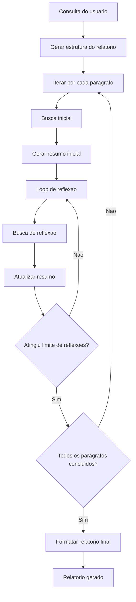
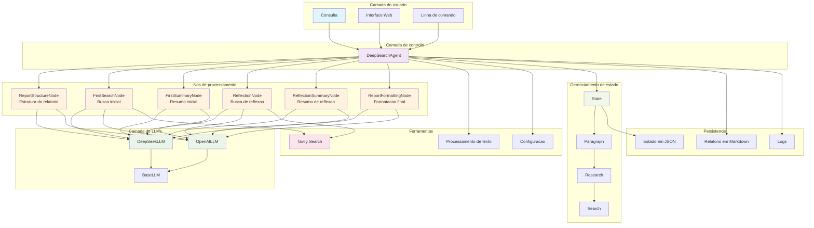

# DeepSearchAgent

[](https://python.org)
[](LICENSE)
[](https://platform.deepseek.com/)
[](https://tavily.com/)

Um agente de pesquisa profunda com IA, **sem dependencia de frameworks** como LangChain. Gera relatorios de pesquisa de alta qualidade em Markdown atraves de buscas iterativas com mecanismo de reflexao.


## Funcionalidades

- **Sem framework**: Implementado do zero, sem dependencia de frameworks pesados
- **Suporte a multiplos LLMs**: Compativel com DeepSeek, OpenAI e outros modelos de linguagem
- **Busca inteligente**: Integracao com o motor de busca Tavily para pesquisas web de alta qualidade
- **Mecanismo de reflexao**: Otimizacao em multiplas rodadas para garantir profundidade e completude da pesquisa
- **Gerenciamento de estado**: Rastreamento completo do processo de pesquisa com suporte a salvamento e retomada
- **Interface web**: Interface amigavel com Streamlit
- **Saida em Markdown**: Relatorios de pesquisa formatados em Markdown

## Como funciona

O DeepSearchAgent utiliza uma abordagem de pesquisa em etapas:



### Fluxo principal

1. **Geracao de estrutura**: Gera o outline e a estrutura de paragrafos a partir da consulta
2. **Pesquisa inicial**: Cria queries de busca para cada paragrafo e coleta informacoes relevantes
3. **Resumo inicial**: Gera o primeiro rascunho de cada paragrafo com base nos resultados da busca
4. **Reflexao e refinamento**: Multiplas rodadas de reflexao para identificar lacunas e complementar a pesquisa
5. **Integracao final**: Consolida todos os paragrafos em um relatorio completo em Markdown

## Inicio rapido

### 1. Pre-requisitos

Python 3.9 ou superior:

```bash
python --version
```

### 2. Clonar o repositorio

```bash
git clone https://github.com/666ghj/BettaFish.git
cd BettaFish
```

### 3. Instalar dependencias

```bash
# Criar e ativar ambiente virtual (recomendado)
python -m venv venv
source venv/bin/activate  # Linux/macOS
# venv\Scripts\activate   # Windows

# Instalar dependencias
pip install -r requirements.txt
```

### 4. Configurar chaves de API

Edite o arquivo `config.py` na raiz do projeto com suas chaves:

```python
# Chaves de API
DEEPSEEK_API_KEY = "sua_chave_deepseek"
OPENAI_API_KEY = "sua_chave_openai"       # Opcional
TAVILY_API_KEY = "sua_chave_tavily"

# Configuracoes do modelo
DEFAULT_LLM_PROVIDER = "deepseek"
DEEPSEEK_MODEL = "deepseek-chat"
OPENAI_MODEL = "gpt-4o-mini"

# Parametros do agente
MAX_REFLECTIONS = 2
SEARCH_RESULTS_PER_QUERY = 3
SEARCH_CONTENT_MAX_LENGTH = 20000
OUTPUT_DIR = "reports"
SAVE_INTERMEDIATE_STATES = True
```

### 5. Executar

Escolha uma das formas de uso abaixo.

## Formas de uso

### Opcao 1: Scripts de exemplo

**Uso basico** - executa uma consulta pre-definida e exibe o resultado:

```bash
python examples/basic_usage.py
```

**Uso avancado** - demonstra configuracao personalizada, multiplas pesquisas e gerenciamento de estado:

```bash
python examples/advanced_usage.py
```

### Opcao 2: Interface web

Inicie a interface Streamlit (as chaves de API podem ser inseridas diretamente na interface):

```bash
streamlit run examples/streamlit_app.py
```

### Opcao 3: Via codigo

```python
from src import DeepSearchAgent, load_config

# Carregar configuracao do config.py
config = load_config()

# Criar o agente
agent = DeepSearchAgent(config)

# Executar pesquisa
relatorio = agent.research("Tendencias de inteligencia artificial em 2025", save_report=True)
print(relatorio)
```

### Opcao 4: Configuracao personalizada via codigo

```python
from src import DeepSearchAgent, Config

# Configuracao customizada
config = Config(
    default_llm_provider="deepseek",
    deepseek_model="deepseek-chat",
    max_reflections=3,           # Mais rodadas de reflexao
    max_search_results=5,        # Mais resultados por busca
    output_dir="meus_relatorios" # Diretorio de saida personalizado
)

# Definir chaves de API
config.deepseek_api_key = "sua_chave"
config.tavily_api_key = "sua_chave_tavily"

agent = DeepSearchAgent(config)
```

## Estrutura do projeto

```
DeepSearchAgent-Demo/
├── src/                              # Codigo-fonte principal
│   ├── agent.py                      # Classe principal DeepSearchAgent
│   ├── llms/                         # Modulo de LLMs
│   │   ├── base.py                   # Classe base abstrata (BaseLLM)
│   │   ├── deepseek.py               # Implementacao DeepSeek
│   │   └── openai_llm.py             # Implementacao OpenAI
│   ├── nodes/                        # Nos de processamento (pipeline)
│   │   ├── base_node.py              # Classes base dos nos
│   │   ├── report_structure_node.py  # Geracao de estrutura do relatorio
│   │   ├── search_node.py            # Nos de busca (inicial e reflexao)
│   │   ├── summary_node.py           # Nos de resumo (inicial e reflexao)
│   │   └── formatting_node.py        # Formatacao do relatorio final
│   ├── prompts/                      # Prompts do sistema
│   │   └── prompts.py                # Definicoes de todos os prompts
│   ├── state/                        # Gerenciamento de estado
│   │   └── state.py                  # Dataclasses (State, Paragraph, Research, Search)
│   ├── tools/                        # Ferramentas externas
│   │   └── search.py                 # Integracao com Tavily Search
│   └── utils/                        # Utilitarios
│       ├── config.py                 # Gerenciamento de configuracao (Config)
│       └── text_processing.py        # Processamento de texto e JSON
├── examples/                         # Exemplos de uso
│   ├── basic_usage.py                # Exemplo basico
│   ├── advanced_usage.py             # Exemplo avancado
│   └── streamlit_app.py              # Interface web Streamlit
├── reports/                          # Diretorio de saida dos relatorios
├── config.py                         # Arquivo de configuracao (chaves de API)
├── requirements.txt                  # Dependencias Python
├── LICENSE                           # Licenca MIT
└── README.md                         # Este arquivo
```

## Arquitetura



## Referencia da API

### DeepSearchAgent

Classe principal do agente de pesquisa.

```python
class DeepSearchAgent:
    def __init__(self, config: Optional[Config] = None)
    def research(self, query: str, save_report: bool = True) -> str
    def get_progress_summary(self) -> Dict[str, Any]
    def load_state(self, filepath: str)
    def save_state(self, filepath: str)
```

| Metodo | Descricao |
|--------|-----------|
| `research(query, save_report)` | Executa a pesquisa completa e retorna o relatorio em Markdown |
| `get_progress_summary()` | Retorna um dicionario com o progresso atual da pesquisa |
| `load_state(filepath)` | Carrega o estado de uma pesquisa anterior a partir de um arquivo JSON |
| `save_state(filepath)` | Salva o estado atual da pesquisa em um arquivo JSON |

### Config

Classe de configuracao que controla o comportamento do agente.

```python
class Config:
    # Chaves de API
    deepseek_api_key: Optional[str]
    openai_api_key: Optional[str]
    tavily_api_key: Optional[str]

    # Configuracao do modelo
    default_llm_provider: str = "deepseek"
    deepseek_model: str = "deepseek-chat"
    openai_model: str = "gpt-4o-mini"

    # Configuracao de busca
    max_search_results: int = 3
    search_timeout: int = 240
    max_content_length: int = 20000

    # Configuracao do agente
    max_reflections: int = 2
    max_paragraphs: int = 5
```

## Exemplos

### Pesquisa basica

```python
from src import create_agent

agent = create_agent()
relatorio = agent.research("Estado atual da computacao quantica")
print(relatorio)
```

### Parametros personalizados

```python
from src import DeepSearchAgent, Config

config = Config(
    max_reflections=4,        # Reflexao mais profunda
    max_search_results=8,     # Mais resultados de busca
    max_paragraphs=6          # Relatorio mais extenso
)

agent = DeepSearchAgent(config)
relatorio = agent.research("Questoes eticas da inteligencia artificial")
```

### Gerenciamento de estado

```python
# Iniciar pesquisa
agent = DeepSearchAgent()
relatorio = agent.research("Aplicacoes de blockchain")

# Salvar estado
agent.save_state("pesquisa_blockchain.json")

# Retomar posteriormente
novo_agent = DeepSearchAgent()
novo_agent.load_state("pesquisa_blockchain.json")

# Verificar progresso
progresso = novo_agent.get_progress_summary()
print(f"Progresso: {progresso['progress_percentage']}%")
```

### Suporte a multiplos modelos

```python
# Usar DeepSeek (padrao)
config = Config(default_llm_provider="deepseek")

# Usar OpenAI
config = Config(default_llm_provider="openai", openai_model="gpt-4o")
```

## Perguntas frequentes

### Quais LLMs sao suportados?

- **DeepSeek**: Recomendado, melhor custo-beneficio
- **OpenAI**: GPT-4o, GPT-4o-mini, entre outros
- Novos modelos podem ser adicionados facilmente herdando a classe `BaseLLM`

### Como obter as chaves de API?

| Servico | Link | Observacao |
|---------|------|------------|
| DeepSeek | [platform.deepseek.com](https://platform.deepseek.com/) | Recomendado |
| Tavily | [tavily.com](https://tavily.com/) | 1.000 buscas gratuitas por mes |
| OpenAI | [platform.openai.com](https://platform.openai.com/) | Opcional |

Apos obter as chaves, edite o arquivo `config.py` na raiz do projeto.

### Como melhorar a qualidade dos relatorios?

- Aumentar `max_reflections` (mais rodadas de reflexao)
- Aumentar `max_search_results` (mais resultados por busca)
- Ajustar `max_content_length` (conteudo mais extenso por resultado)
- Usar um modelo LLM mais poderoso

### Como personalizar os prompts?

Edite o arquivo `src/prompts/prompts.py` para ajustar o comportamento do agente.

### Outros motores de busca sao suportados?

Atualmente apenas o Tavily e suportado. Para adicionar outros, modifique `src/tools/search.py`.

## Contribuicao

Contribuicoes sao bem-vindas! Siga os passos:

1. Faca um fork do projeto
2. Crie uma branch para sua feature (`git checkout -b feature/MinhaFeature`)
3. Commit suas alteracoes (`git commit -m 'Adicionar MinhaFeature'`)
4. Envie para a branch (`git push origin feature/MinhaFeature`)
5. Abra um Pull Request

## Licenca

Este projeto esta licenciado sob a licenca MIT - veja o arquivo [LICENSE](LICENSE) para mais detalhes.

## Agradecimentos

- [DeepSeek](https://www.deepseek.com/) pelo excelente servico de LLM
- [Tavily](https://tavily.com/) pela API de busca de alta qualidade

---

Se este projeto foi util para voce, deixe uma estrela!

---

Projeto adaptado da comunidade ARCKHÉ TDS - ARCKHÉe